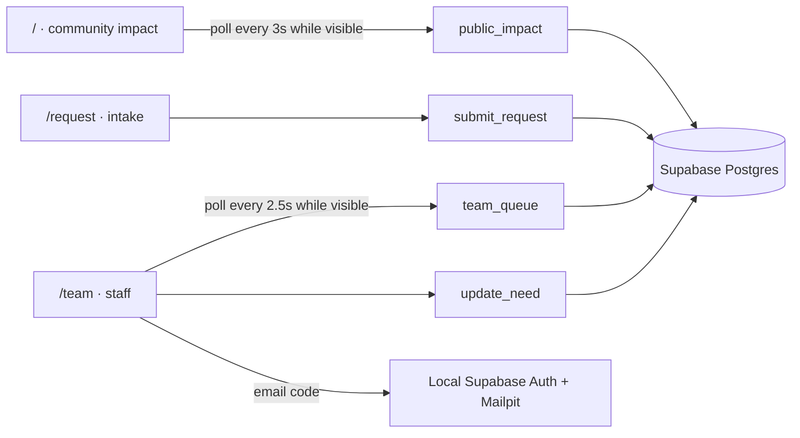

# ComForce Connect

Community Task Force MKE uses this local demo to follow a Milwaukee request from first contact to delivery. A request can include several needs, each with its own worker, referrals and outcome.

| Route | What you can do |
| --- | --- |
| `/` | Explore fictional monthly outcomes by neighborhood and service. |
| `/request` | Request several services in one submission and receive a reference number. |
| `/team` | Log calls and texts, assign work, follow up on referrals and confirm delivery. |

Start with the [Windows local development guide](docs/LOCAL_DEVELOPMENT.md). For branches and PRs, see [Contributing](CONTRIBUTING.md).

**Reading impact.** A sent referral counts in the month it was sent. A need counts when delivery is confirmed. A request helped is one distinct request with at least one confirmed delivery in the selected scope. All three use Chicago dates. The figures describe recorded fictional activity.

**Geography.** The map uses locally simplified boundaries from Milwaukee’s Department of City Development and ITMD-GIS. Section 3(b) of the City’s Open Data Policy places published datasets in the public domain. ComForce activities come from a separate fictional seed. [City neighborhood layer](https://milwaukeemaps.milwaukee.gov/arcgis/rest/services/AGO/neighborhoods/MapServer/0) · [Milwaukee Open Data Policy](https://city.milwaukee.gov/ImageLibrary/Groups/cityOpenData/MilwaukeeOpenDataPolicy.pdf)

**Demo access.** Public visitors can submit a request and read aggregates. Only the verified local staff account can open case details and update needs. Its sign-in code is delivered to the developer’s local Mailpit inbox. Keep the stack on a trusted machine or LAN and use made-up contact details. A publicly accessible staff demo would need isolated workspaces or fixed sample inputs first.

**Source credits.** Andrew Bieber supplied the brief and starter guides. Codex (GPT-6) implemented the application and tests. Two hand-authored JSON files omit comment headers. Codex configured dependencies and commands in `package.json` and compiler options in `tsconfig.json`. The map asset and npm lockfile are generated.
