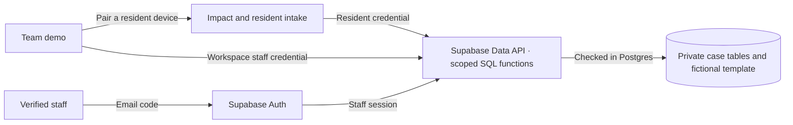

# ComForce Connect

Community Task Force MKE helps Milwaukee residents get food, rides and family support. This Hacksgiving demo follows a request from the first call, text or web submission through partner contact and confirmed delivery. Use fictional details throughout.

| Open on the demo laptop | What to try |
| --- | --- |
| [Community impact](http://127.0.0.1:5173/) | Tap a neighborhood and change the month. The map, outcome totals and six-month trend update together. |
| [Neighborhood data](http://127.0.0.1:5173/safety) | Watch a 30-second heatmap of aggregated MPD incidents, pause on a month and compare the same 2025–2026 period. |
| [Request help](http://127.0.0.1:5173/request) | Ask for multiple services and receive one reference. [Start with family support](http://127.0.0.1:5173/request?service=family_support). |
| [Team workspace](http://127.0.0.1:5173/team) | Open a private fictional queue, pair a resident device, assign a worker and record a callback. |

Four routes share one React/Vite build. The public impact page reads one shared, read-only fictional template without creating a workspace. Opening the team demo or submitting a request creates a private copy that expires after 24 hours; at most 50 visitor workspaces can be active. A paired resident link grants submission and aggregate access to the laptop’s workspace. The separate [verified staff entrance](http://127.0.0.1:5173/team?mode=staff) reads the original staff records. Neighborhood data is a static, aggregate public-data view and does not require Supabase.



## Reading the atlas

- **Reported by ComForce MKE.** The organization reports 10,000+ Milwaukee residents served and 300+ volunteers and partners. It gives no reporting period. Its Missing Persons Network provides family support. [Organization](https://www.comforcemilwaukee.com/) · [Programs](https://www.comforcemilwaukee.com/programs)
- **Milwaukee historical context.** The city recorded 4,618 people reported missing to MPD in 2002 and 4,316 in 2004. A person can appear in multiple reports. These dated citywide snapshots measure reporting to police. [2002, p. 41](https://city.milwaukee.gov/ImageLibrary/Groups/cityFPC/Reports/2002PSAFETY.pdf#page=41) · [2004, p. 26](https://city.milwaukee.gov/ImageLibrary/Groups/cityFPC/Reports/2004PSAFETY.pdf#page=26)
- **Interactive demo activity.** April–November 2026 history covers six neighborhoods. Requests helped counts distinct requests with at least one confirmed delivery. Referrals count when sent. Completed family callbacks count independently of fulfillment. All use the month of the event in Chicago.
- **Published neighborhood context.** The `/safety` page counts unique MPD NIBRS case numbers within the same six City neighborhood polygons. The looping map covers January–October 2026; the table compares the same period in 2025 and 2026. Counts are not population-adjusted rates or safety ratings. [Incident data](https://data.milwaukee.gov/dataset/e5feaad3-ee73-418c-b65d-ef810c199390/resource/87843297-a6fa-46d4-ba5d-cb342fb2d3bb/download/wibr.csv) · [City disclaimer](https://staticwebfiles.milwaukee.gov/main/compass/disclaimerQuery.html)
- Figure definitions and evidence are in [publishedFacts.ts](src/impact/publishedFacts.ts). The map uses public-domain City of Milwaukee neighborhood boundaries and Census hydrography. [City GIS](https://milwaukeemaps.milwaukee.gov/arcgis/rest/services/AGO/neighborhoods/MapServer/0) · [City data policy](https://city.milwaukee.gov/ImageLibrary/Groups/cityOpenData/MilwaukeeOpenDataPolicy.pdf) · [2025 Census TIGER/Line water, Milwaukee](https://www2.census.gov/geo/tiger/TIGER2025/AREAWATER/tl_2025_55079_areawater.zip) · [Ozaukee](https://www2.census.gov/geo/tiger/TIGER2025/AREAWATER/tl_2025_55089_areawater.zip)

## Hosting checklist

### Supabase

1. In [your Supabase dashboard](https://supabase.com/dashboard), select **New project**, choose your organization and create a dedicated project named **comforce-connect-demo**. Save the database password privately. Once ready, copy its project reference, HTTPS project URL and **publishable** key.
2. From the approved checkout with dependencies installed, run the following against that project. Review the dry run before applying the schema. [Supabase migration guide](https://supabase.com/docs/guides/deployment/database-migrations)

```sh
npx supabase login
npx supabase link --project-ref YOUR_PROJECT_REF
npx supabase db push --dry-run
npx supabase db push
```

3. Load demo data separately. In this project’s **SQL Editor**, run the contents of [demo_seed.sql](supabase/demo_seed.sql) once. Reruns preserve the template and all existing workspaces. The older [seed.sql](supabase/seed.sql) supplies the local verified-staff fixtures and is only needed for that local test setup.
4. Keep the Data API enabled with `public` exposed and `comforce` private. Demo visitors need only the publishable key. Leave anonymous Auth sign-ins disabled. For verified staff, enable Email Auth and email confirmation, configure outbound mail, select a six-digit OTP, and include `{{ .Token }}` in both **Confirm signup** and **Magic link** email templates. Set the production Site URL to your Pages HTTPS address. Provision each Auth user first, then add their verified lowercase address, display name and role with `insert into comforce.staff(email,display_name,role) values ('admin@example.org','Alex','administrator');`. Use `caseworker` for staff who should see and update only assigned needs. Administrators can see the full queue and assign or reassign work. Every real staff submission and case action stores `auth.uid()` plus role and display-name snapshots in private audit/history records. [API keys](https://supabase.com/docs/guides/getting-started/api-keys) · [Email OTP](https://supabase.com/docs/guides/auth/auth-email-passwordless)

### Staff-role rollout

Apply the database migrations before deploying the matching frontend. New allowlisted accounts default to `caseworker`. Existing staff keep their current roles. Before real use, review the administrator list and set each account to the role it needs. Legacy owner labels are linked only when one verified account matches; unmatched labels appear in **Unassigned** as “link account” work for an administrator.

Already-open tabs remain usable during the transition: the new frontend falls back when `staff_context` has not reached the database yet, and the new database accepts the old frontend’s label-based, keyless updates while generating and auditing a server operation ID. After both halves are deployed, ask staff to finish any visible save, then hard-refresh or close and reopen every staff tab. This refresh is required to load role-scoped screens and operation keys that survive a lost response plus reload.

Use this release order and smoke check:

1. Run `npx supabase db push --dry-run`, then `npx supabase db push`.
2. Confirm an administrator can see **Unassigned**, assign one need, and that a caseworker sees only that assigned need.
3. Deploy the frontend, hard-refresh all staff tabs, and log a phone request as a caseworker. The saved case must open and remain in that worker’s queue.
4. On a mixed transportation/family-support request, assign only transportation to the caseworker. Confirm the worker cannot see the family safe-contact or agency fields.
5. Simulate a lost response while saving a referral, reload, and retry the same referral. Confirm the history and referral list each contain one entry.

### Cloudflare Pages

After Andrew promotes the feature to `main`, choose **Workers & Pages → Create → Pages → Connect to Git** and select `andrew9990828/comforce-connect`. Use these production build settings. [Build settings](https://developers.cloudflare.com/pages/configuration/build-configuration/) · [Node version](https://developers.cloudflare.com/pages/configuration/build-image/)

| Setting | Value |
| --- | --- |
| Production branch | `main` |
| Root directory | Leave blank (repository root) |
| Build command | `npm run build` |
| Output directory | `dist` |
| Build environment | `NODE_VERSION=22.15.0` |
| Public build variables | `VITE_SUPABASE_URL=https://YOUR_PROJECT_REF.supabase.co` and `VITE_SUPABASE_PUBLISHABLE_KEY=sb_publishable_…` from the same project |

Pages serves the three routes from `index.html` using its default SPA fallback. Browser requests go straight to the configured HTTPS Supabase project. Rebuild after changing a Vite variable. [Pages routing](https://developers.cloudflare.com/pages/configuration/serving-pages/)

**Hosted smoke test, pending deployment.** On the laptop open the assigned `pages.dev/team` URL and pair the phone. On cellular, open the resident link, request family support and a ride, then record a callback on the laptop. Refresh Impact, Request help and the team case directly. Check that the callback increases once, transportation stays open and the atlas receives only monthly neighborhood totals. In a clean browser, paste the first case’s team URL and verify it is unavailable. See [local checks and pairing](docs/LOCAL_DEVELOPMENT.md) and [the PR workflow](CONTRIBUTING.md).

Andrew Bieber supplied the brief and starter guides. OpenAI Codex (GPT-6) implemented the application, SQL, tests and presentation guides. The JSON package and TypeScript configurations omit inline credits. The bundled map geometry and npm lockfile are generated.
